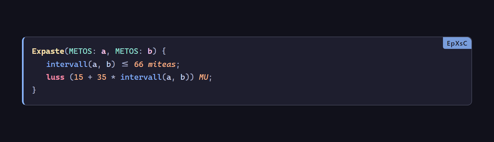

# EpXsC Syntax

[English](README.md) | [简体中文](README.zh-CN.md)

   

An Obsidian plugin for **EpXsC (Expaulxsirian Construct)**, a fictional conlang used in a novel. It provides syntax highlighting, hover glosses and linting for EpXsC fenced code blocks.

> This plugin is for a fictional language only. It is not related to any real-world language. It is also an experiment for a future corpus/glossary toolchain.



*Rendered by the plugin in Obsidian: token colors, frame and language tag.*

> The code samples below are source examples. In Obsidian, the plugin renders them with the same frame and colors; the community page does not load plugin styles.


## Features

- **Syntax highlighting** for `EpXsC`, `EpXsT` and `EpXsG` fenced blocks; language names are case-insensitive.
- **Hover glosses** on tokens: part of speech, meaning and abbreviation from the vault dictionary.
- **Linting** with one command: bracket matching, clause order, unit compatibility, `consta` rewrites, axis arity and more.
- **Vault data first**: reads the dictionary / grammar / rank / root files from the vault; falls back to a built-in snapshot when they are absent.
- **Reading view + Live Preview**: both render; click a rendered block to go back to source editing.
- **Mobile friendly**: narrow screens keep the frame, translation and gloss lines readable.
- **Optional CSS snippet** for users who only want the visual style.
- **Reusable core**: tokenizer, grammar, parsers and linter are Obsidian-free and can be consumed by CLI or other editors.

## Installation

### Community plugins

1. Open Obsidian → **Settings → Community plugins**, turn off Restricted mode.
2. Click **Browse**, search for **EpXsC Syntax**.
3. **Install → Enable**. `styles.css` loads with the plugin; no extra CSS snippet is required.

### BRAT

Add the repository `Shir0Tak1na/EpXsC-Syntax`, then enable the plugin.

### Manual installation

1. Download `main.js`, `manifest.json` and `styles.css` from a Release.
2. Put them in `<vault>/.obsidian/plugins/epxsc-syntax/`.
3. Restart Obsidian → Settings → Community plugins → enable **EpXsC Syntax**.

## Usage

### Fenced blocks

| Language | Purpose |
| :-- | :-- |
| `EpXsC` | Spell/technique body: coloring, glosses and linting |
| `EpXsT` | Sentence pairs: source and translation laid out per block |
| `EpXsG` | Grammar annotation: part-of-speech/constituent labels under each word |

`EpXsC` / `epxsc` / `EPXSC` are equivalent; the same applies to `EpXsT` and `EpXsG`.

For `EpXsT`, the translation must be inside the same block: one source line followed by a translation line starting with `>` (or a line containing CJK characters).

```EpXsT
Tallse aris agrus nec manis humal.
> The fields must stay moist when plowing.
```

`EpXsG` annotates each word with its part of speech, followed by the translation.

Translations can also carry BCP-47 language tags. Only the translation matching the current Obsidian language is shown; untagged `>` lines remain the default translation. A missing translation renders `尚未翻译 / Untranslated`.

```EpXsT
Tallse aris agrus nec manis humal.
> (zh-CN) 凡耕田，必须保持湿润。
> (en) Fields must stay moist when plowing.
```

Language, fallback language, and custom lexicons are configured in **Settings → EpXsC Syntax**.

### Hover

In Reading view and Live Preview, hover a token to see its category and meaning. On mobile, touch-hover works without double-clicking the block.

### Commands

Search **EpXsC** in the command palette:

| Command | Action |
| :-- | :-- |
| 检查当前笔记的 EpXsC 代码块 | Open the lint panel; click a result to jump to the line |
| 重新载入词表与释义 | Reload dictionary/grammar/rank data after vault edits |
| EpXsC 自检（视图／token／颜色／样式表） | Diagnose missing colors or hover |
| EpXsC 诊断报告 | Write a diagnostic report to the vault root |
| 重载 EpXsC 插件 | Reminder to disable/enable the plugin in settings |

## Dictionaries

At startup the plugin reads these sources when present:

| Path | Provides |
| :-- | :-- |
| `世界设定集/地域文化图鉴/语言/述无空语/述无空语词典.md` | Part of speech, meaning, abbreviation |
| `世界设定集/地域文化图鉴/语言/述无空语/述无空语术式语法.md` | Filter keys, unit tables |
| `世界设定集/设定概念集合/维度/维度模型.md` | Rank/ dimension mapping |
| `世界设定集/地域文化图鉴/语言/述无空语/词库/词根表/` | Root volumes (whole directory) |
| `世界设定集/设定概念集合/魔法/` | Spell declaration registry (whole directory) |

Edit `DICT_PATH`, `SYNTAX_PATH`, `RANK_PATH`, `ROOTS_DIR` and `SPELL_DIR` in `src/adapter/config.js` for a different vault layout, then run `npm run build`.

When a source is unavailable, the plugin uses `data/builtin-lexicon.json` (`schemaVersion` 1). The snapshot is canonicalized and validated by `scripts/generate-lexicon.mjs --check`.

## Customization

Colors are CSS variables in `styles.css`: `--epx-comment`, `--epx-decl`, `--epx-keyword`, `--epx-type`, `--epx-verb` and others. Change the variables instead of editing `main.js`.

For colors only, put `snippets/EpXsC-Highlight.css` into `<vault>/.obsidian/snippets/` and enable it under Appearance → CSS snippets. The snippet provides the frame/static style, not token coloring.

## Compatibility

- Minimum Obsidian **1.4.0**; desktop and mobile are supported.
- Reading view and Live Preview are supported. In Live Preview, placing the cursor inside a block shows the source; this is Obsidian's default behavior.
- Blocks longer than **50 lines** keep the plain code-block appearance and skip token coloring for performance.
- The outer frame is added as the `pre.epx-pre` class by the plugin; it no longer depends on `:has()`.
- The plugin makes no network requests and does not modify notes.

## Core API

The pure core does not import Obsidian, DOM or vault APIs:

```js
const core = require('./src/core');

const dict = core.parseDictionary(text);
const grammar = core.buildGrammar(lists, keys);
const html = core.tokenize(source, grammar);
const spells = core.collectSpells(source, new Map(), 'file.md');
const issues = core.lint(source, { info, units, keys, spells, path });
```

Stable aliases: `extractBlocks`, `parseDictionary`, `buildGrammar`, `tokenize`, `lint`.

## CLI

The same core is available without Obsidian:

```bash
node bin/epxsc.mjs tokenize note.md
node bin/epxsc.mjs lint note.md --dictionary path/to/dictionary.md --syntax path/to/syntax.md
```

See [docs/CLI.md](docs/CLI.md) for commands, JSON output and exit codes.

## Development

Source lives in `src/`; the root `main.js` is an esbuild bundle — do not edit it by hand.

```bash
npm install       # install esbuild
npm run build     # src/main.js -> main.js
npm run check     # manifest / syntax / CSS / lexicon canonical form
npm test          # behavior tests + tokenizer/parser/lint/markup fixtures
```

| Path | Purpose |
| :-- | :-- |
| `src/main.js` | Build entry; requires the adapter only |
| `src/adapter/plugin.js` | Obsidian adapter: lifecycle, DOM, hover, commands, processors |
| `src/adapter/config.js` | Vault source paths and highlight limit |
| `src/core/` | Pure language logic: grammar / tokenizer / markup / lint / spells / fences |
| `src/core/index.js` | Stable core entry and aliases |
| `src/data/parsers.js` | Dictionary / roots / ranks / filter keys / units parsing |
| `src/data/lexicon.js` | Built-in snapshot schema gate |
| `data/builtin-lexicon.json` | Canonical built-in lexicon snapshot |
| `styles.css` | Token colors, code-block frame, T/G layout |
| `snippets/EpXsC-Highlight.css` | Standalone color snippet |
| `manifest.json` / `versions.json` | Plugin metadata and version map |
| `docs/ARCHITECTURE.md` | Actual Core / Adapter / Data layers |
| `docs/ROADMAP.md` | Architecture-review execution plan |
| `docs/RELEASING.md` | Release policy: at most one GitHub Release per day |

Local debugging: put the repository in `<vault>/.obsidian/plugins/epxsc-syntax/`, run `npm run build`, then disable/enable the plugin in Obsidian. A Release contains exactly `main.js`, `manifest.json` and `styles.css`.

## Release notes

[CHANGELOG.md](CHANGELOG.md) · [ROADMAP.md](docs/ROADMAP.md) · [GitHub Releases](https://github.com/Shir0Tak1na/EpXsC-Syntax/releases) · [Release policy](docs/RELEASING.md): at most one Release per day.

## License

[Apache-2.0](LICENSE)

[](https://github.com/deepseek-ai/deepseek-harness)
